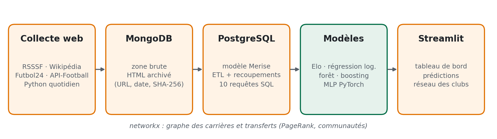
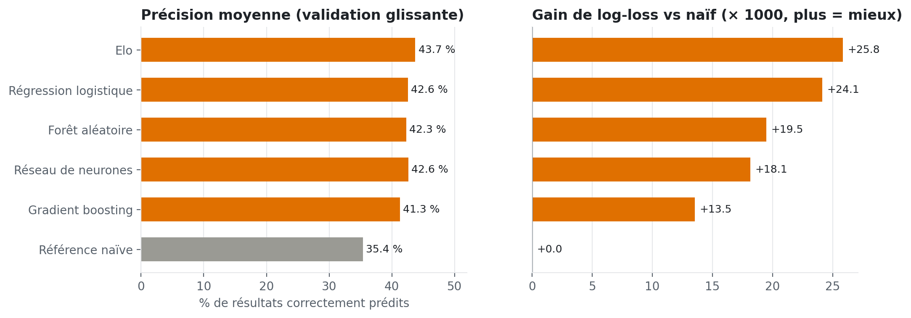
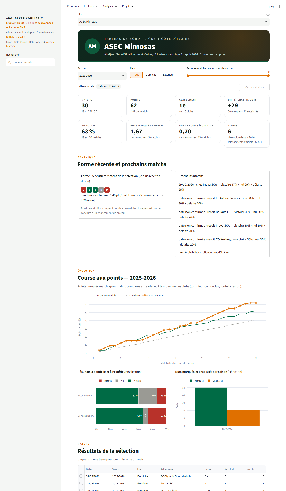
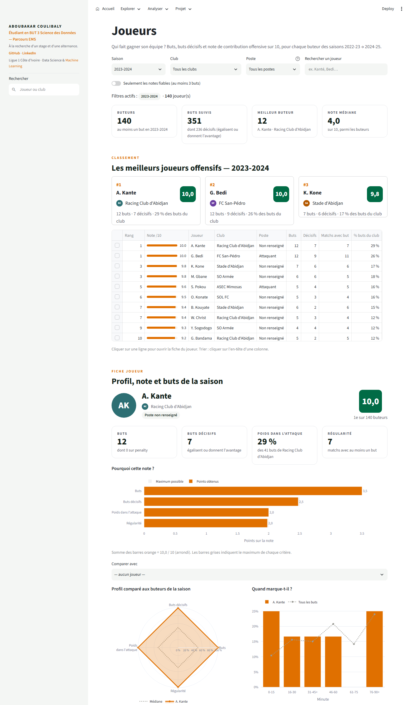
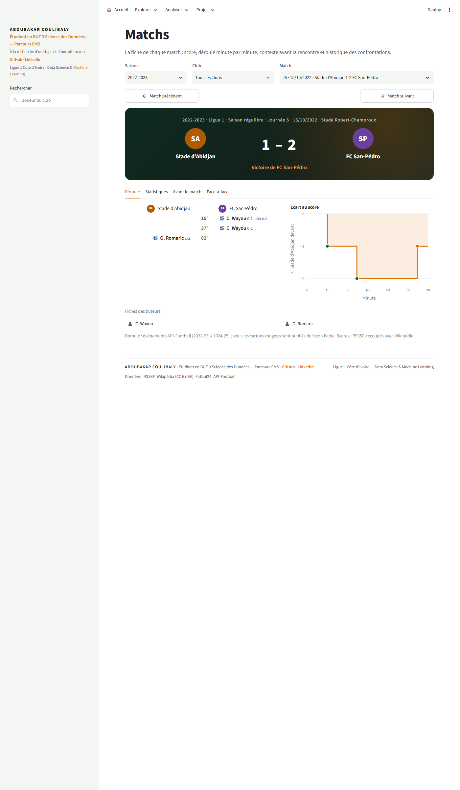
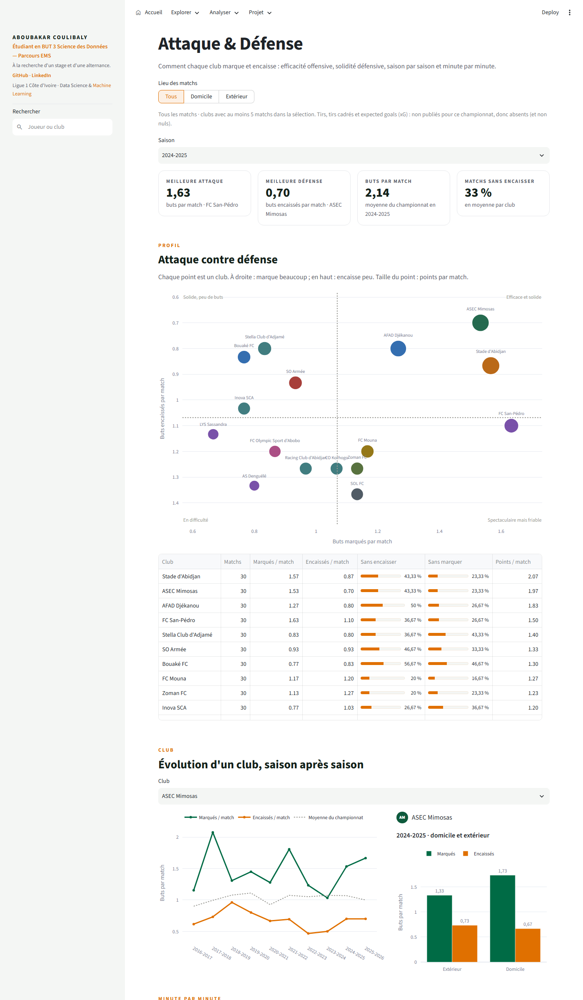

# Plateforme d'analyse de la Ligue 1 ivoirienne

Pipeline de données complet sur 10 saisons de MTN Ligue 1 (2016 → 2026) : collecte web,
MongoDB, PostgreSQL, réseau des clubs, six modèles de prédiction (dont un réseau de neurones
PyTorch) et tableau de bord Streamlit.

## Objectif et impact

La Ligue 1 ivoirienne forme des joueurs pour toute l'Afrique et l'Europe, mais ses données
sont dispersées, incomplètes et presque jamais analysées. Ce projet les rassemble dans une
base fiable, sourcée et gratuite, pour que les acteurs du football ivoirien décident avec des
faits plutôt qu'avec des impressions.

| Pour qui | Ce que ça change | Constat mesuré |
|---|---|---|
| Clubs et entraîneurs | mesurer sa performance sans cellule data | CO Korhogo prend moins de points à domicile (0,89 par match) qu'à l'extérieur (1,28) sur 148 matchs |
| Joueurs, agents, recruteurs | rendre visibles les talents locaux | 563 départs suivis vers 402 clubs hors Ligue 1, dont 42 % depuis la seule ASEC |
| Médias et supporters | débattre avec des chiffres vérifiés | scores recoupés entre trois sources, probabilités de match expliquées |
| Ligue et Fédération | piloter l'équilibre du championnat | 6 titres sur 10 pour l'ASEC, 30 % de nuls, 2 buts par match |

Ce n'est pas un outil de paris : les probabilités servent à comprendre le championnat.



**Démo** : _lien Streamlit Community Cloud à ajouter après déploiement_ ·
**Rapport** : [docs/rapport.pdf](docs/rapport.pdf) (9 pages)

## Résultats

| | |
|---|---|
| Matchs collectés | 1 934 matchs joués, 10 saisons complètes + 2026-27 en cours |
| Nuls | 30 % des matchs (≈ 25 % en Europe), 2,06 buts par match |
| Domination | ASEC Mimosas : 6 titres sur 10, club le plus central du réseau des transferts |

Prédiction du résultat (victoire domicile / nul / victoire extérieur). Validation temporelle
glissante : chaque saison 2021-22 → 2025-26 est prédite par un modèle entraîné uniquement
sur les saisons précédentes (1 141 matchs prédits).

| Modèle | Précision | Log-loss |
|---|---|---|
| **Elo** (retenu) | **43,7 %** | **1,0715** |
| Régression logistique | 42,6 % | 1,0732 |
| Forêt aléatoire | 42,3 % | 1,0779 |
| Réseau de neurones (MLP PyTorch) | 42,6 % | 1,0792 |
| Gradient boosting | 41,3 % | 1,0838 |
| Référence naïve (toujours domicile) | 35,4 % | 1,0974 |

Tous les modèles battent la référence naïve de façon significative (bootstrap, IC 95 %).
Le modèle simple fondé sur l'Elo fait aussi bien que les modèles complexes : avec ≈ 240
matchs par saison et 30 % de nuls, la qualité de l'évaluation compte plus que l'algorithme.
Détails : page **Modèles** du tableau de bord, [notebooks/02_modelisation.ipynb](notebooks/02_modelisation.ipynb).



## Démarrage rapide (sans base de données ni clé API)

Le tableau de bord ne lit que les données réelles exportées dans `app/data/` (versionnées) :

```bash
pip install -r app/requirements.txt
streamlit run app/Accueil.py        # http://localhost:8501
```

| | |
|---|---|
|  |  |
|  |  |

## Installation complète (collecte, bases, modèles)

```bash
cp .env.example .env
docker compose up -d
pip install -e ".[dev,modele]"
```

## Pipeline

```bash
make collect   # collecte web + API (≈ 1 min hors API ; reprise automatique du quota API)
make etl       # MongoDB -> PostgreSQL, contrôles, vues matérialisées
make train     # réglages, validation glissante, test 2025-26, modèle final (≈ 5 min)
make export    # données du tableau de bord : app/data/*.parquet
make rapport   # figures (docs/figures) + rapport PDF (docs/rapport.pdf)
make app       # tableau de bord en local : http://localhost:8501
make pipeline  # collect + etl + train + export
```

Sources (RSSSF, Wikipédia, Futbol24, API-Football) et limites : [docs/sources.md](docs/sources.md).
Modèle de données (Merise : MCD, MLD, MPD) : [docs/modele_donnees.md](docs/modele_donnees.md).

### Collecte quotidienne (Windows)

La tâche planifiée « Ligue1CI - collecte quotidienne » lance
`scripts/collecte_quotidienne.bat` chaque jour à 8 h (ou au prochain démarrage du PC).
API-Football (offre gratuite : 100 requêtes/jour) reprend là où elle s'était arrêtée.
Journal : `logs/collecte_quotidienne.log` et `logs/pipeline.log`.

## Ce que fait chaque base

| Base | Rôle |
|---|---|
| MongoDB | zone brute : HTML archivé (URL, date, SHA-256) et documents tels que collectés, par source |
| PostgreSQL | zone analytique : 12 tables normalisées (+ 1 vue), 102 variantes de noms harmonisées en 31 clubs (config/clubs_alias.yml), scores recoupés entre sources, classements recalculés identiques aux officiels ; 10 requêtes dans [sql/analyses/](sql/analyses/), vues matérialisées dans [sql/vues_materialisees.sql](sql/vues_materialisees.sql) |
| Graphe | carrières Wikipédia + transferts API-Football : PageRank, intermédiarité, communautés de Louvain ([src/graphe/analyses.py](src/graphe/analyses.py)) ; calculé avec networkx pour le tableau de bord. **À faire** : chargement dans Neo4j et 5 requêtes Cypher ([cypher/](cypher/) encore vide) |

## Modélisation

- **Variables** ([src/modele/features.py](src/modele/features.py)), calculées uniquement avec
  l'information disponible avant chaque match : Elo (K et avantage du terrain réglés en
  validation), forme sur 5 et 10 matchs, buts glissants, points, rang et différence de
  buts dans la saison, forme à domicile / à l'extérieur, jours de repos.
- **Modèles** : référence naïve, Elo, régression logistique multinomiale, forêt aléatoire,
  gradient boosting ([baselines.py](src/modele/baselines.py)) et MLP PyTorch avec dropout,
  pénalité L2, arrêt anticipé et moyenne de 5 graines ([reseau.py](src/modele/reseau.py)).
- **Évaluation** ([evaluation.py](src/modele/evaluation.py)) : précision, log-loss, Brier,
  RPS, matrice de confusion, calibration, importance par permutation, bootstrap apparié.
- **Choix du modèle** : le plus simple parmi ceux à moins de 0,002 de log-loss du meilleur
  sur 2021 → 2024 ; test final sur 2025-26, jamais utilisé pour un choix.

## Tableau de bord et déploiement

Inspiré d'un tableau de bord du LOSC présenté sur LinkedIn (API Sportmonks), adapté à toute
la Ligue 1 ivoirienne avec des sources gratuites. Correspondance fonctionnalité par
fonctionnalité, preuves et limites : [docs/specifications.md](docs/specifications.md).
Définition, dénominateur et limites de chaque indicateur :
[docs/indicateurs.md](docs/indicateurs.md).

- **Clubs** : tableau de bord d'un club. Bilan, points, classement, différence de buts,
  moyennes, forme et tendance, prochains matchs avec probabilités, course aux points,
  bilan par adversaire. Filtres saison, domicile / extérieur et période, avec remise à zéro.
- **Recherche** : un joueur ou un club depuis n'importe quelle page (barre latérale).

- **Matchs** : fiche de chaque match (adresse partageable `?match=`), match précédent /
  suivant, déroulé minute par minute et écart au score, statistiques (les données non
  publiées sont marquées « Non publié », jamais 0), rang et forme avant le match, face-à-face.
- **Joueurs** : classement et fiche de chaque buteur 2022-23 → 2024-25, avec une note de
  contribution offensive sur 10 (buts, buts décisifs, poids dans l'attaque, régularité ;
  formule dans [src/restitution/joueurs.py](src/restitution/joueurs.py)), décomposée critère
  par critère. Filtres club, poste et notes fiables (≥ 3 buts), comparaison de deux joueurs.
  API-Football ne publie ni temps de jeu ni passes pour ce championnat : la note ne couvre
  que les buteurs et n'est pas une note officielle.
- **Attaque & Défense** : buts marqués / encaissés par club, domicile / extérieur, par
  quart d'heure.

`app/` (Streamlit, 10 pages : Accueil ; Explorer : Championnat, Clubs, Attaque & Défense, Matchs, Joueurs ; Analyser : Réseau, Prédiction, Modèles ; Données & Méthodologie) ne lit
que `app/data/*.parquet` : il se déploie sans base de données.

1. Pousser le dépôt sur GitHub (avec `app/data/`).
2. Sur [share.streamlit.io](https://share.streamlit.io) : *Create app* → dépôt, branche
   `main`, fichier `app/Accueil.py`. Les dépendances légères sont dans
   [app/requirements.txt](app/requirements.txt).
3. Après chaque mise à jour des données : `make pipeline` puis commit de `app/data/` ;
   l'application se met à jour toute seule.

### Variables d'environnement (`.env`, à créer depuis `.env.example`)

| Variable | Rôle | Nécessaire pour |
|---|---|---|
| `MONGO_URI`, `MONGO_DB` | zone brute MongoDB | collecte, ETL, export |
| `PG_URL` (et `PG_PASSWORD` pour Docker) | base analytique PostgreSQL | ETL, modèles, export |
| `API_FOOTBALL_KEY` | clé gratuite api-sports.io (100 requêtes / jour) | collecte des matchs 2022-2024, évènements, effectifs |
| `USER_AGENT`, `DELAI_REQUETES` | identification et politesse du scraping | collecte |
| `NEO4J_*` | graphe (optionnel, non utilisé par le tableau de bord) | — |

Aucune variable n'est nécessaire pour lancer le tableau de bord. `.env` est ignoré par git.

### Actualiser les données

```bash
make collect && make etl && make export   # puis commit de app/data/
```

Sportmonks (API de la référence) a été évaluée : son offre gratuite ne couvre que les
championnats danois et écossais (détails dans [docs/sources.md](docs/sources.md)).

### Tests

`make test` : 108 tests, dont les calculs du tableau de bord (bilans, points, classements,
filtres, navigation entre matchs), la note des joueurs et l'exécution des 10 pages avec les
interactions (filtres, boutons, recherche) via `streamlit.testing`. Ces derniers sont sautés
en CI, où Streamlit n'est pas installé.

## Limites

- ≈ 240 matchs par saison : les écarts entre modèles sont du même ordre que l'incertitude
  d'une saison.
- Buteurs et cartons match par match : 2022-23 → 2024-25 seulement, et pas pour tous les matchs ;
  ni compositions, ni temps de jeu, ni tirs, ni coordonnées (pas de zones d'activité).
- Le réseau ne suit que les joueurs ayant un article Wikipédia (biais vers les grands clubs).
- 2019-20 (arrêt Covid) et 2020-21 (poules + play-off) : classements recalculés approximatifs.

## Valorisation

Post LinkedIn, script de la vidéo, diapositives et vidéo MP4 : [docs/linkedin/](docs/linkedin/).

### Vidéo de présentation narrée (≈ 90 s)

```bash
streamlit run app/Accueil.py --server.port 8599 --client.toolbarMode viewer   # terminal 1
python -m src.restitution.video_pro              # terminal 2 (ou : make video-pro), ≈ 8 min
python -m src.restitution.video_pro --apercu     # images clés seulement (≈ 30 s)
python -m src.restitution.video_pro --sans-voix  # musique + sous-titres, pour enregistrer sa voix
python -m src.restitution.video_pro --sans-voix --sans-musique  # muette, sous-titres seuls
python -m src.restitution.video_pro --controle   # durée, résolution, flux audio du MP4
```

Sorties : `docs/linkedin/video_ligue1_pro.mp4` (1920×1080, H.264 + AAC), sous-titres
`video_ligue1_pro.srt` (à joindre sur LinkedIn), images clés `docs/linkedin/diapos_pro/`.
Voix off : voix française « Paul » de Windows, hors ligne
([tts_windows.ps1](src/restitution/tts_windows.ps1)) ; musique générée par le script (libre de
droits). Les chiffres prononcés sont vérifiés contre `app/data/` avant le montage : si le
pipeline change un résultat, le script s'arrête et indique la phrase à mettre à jour.
Scénario et textes : [docs/linkedin/script_video_pro.md](docs/linkedin/script_video_pro.md).

Sources : RSSSF © José Batalha / Rec.Sport.Soccer Statistics Foundation ; Wikipédia (CC BY-SA) ;
Futbol24 ; API-Football.
