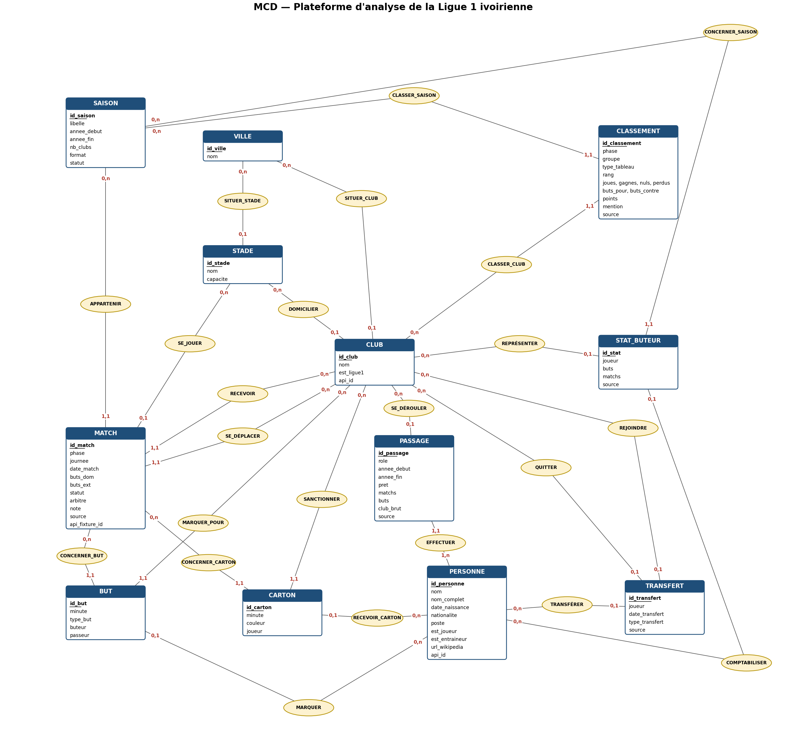
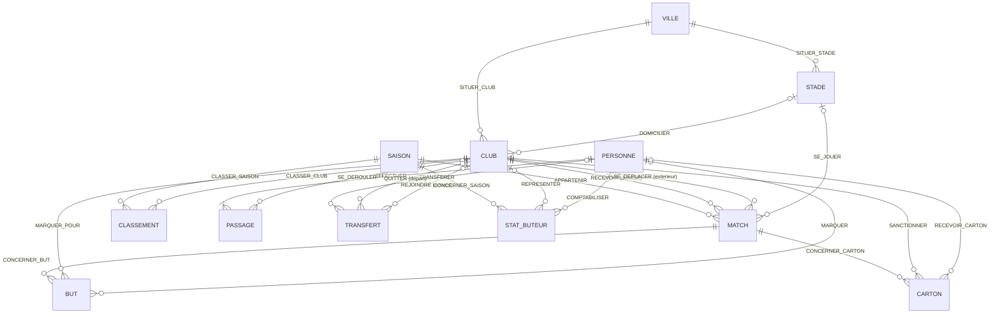
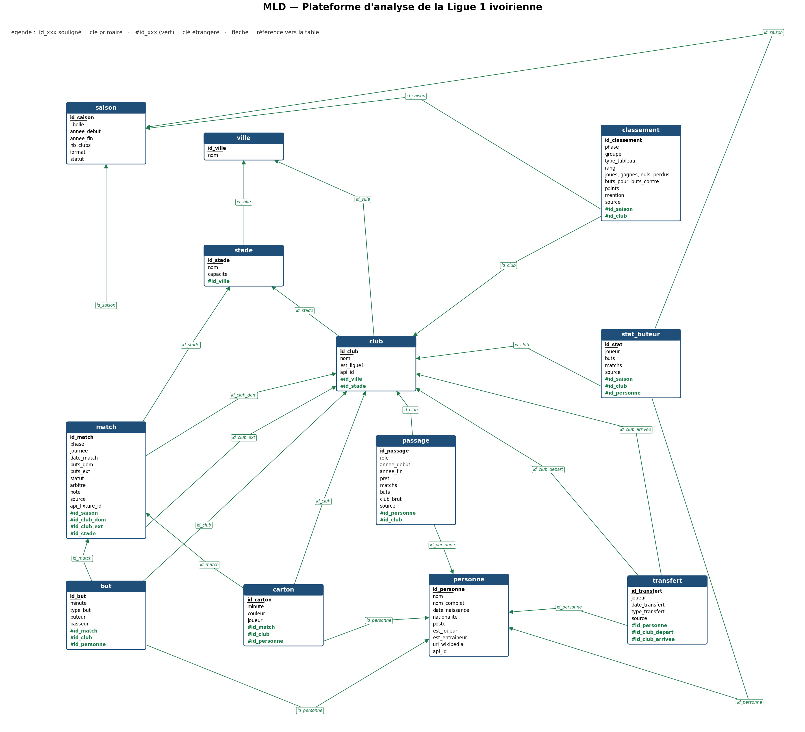

# Modèle de données PostgreSQL — démarche Merise

Démarche : **MCD** (entités, associations, cardinalités) → **MLD** (tables, clés)
→ **MPD** (`sql/schema.sql`, PostgreSQL) → alimentation par l'ETL (`python -m src.etl.run`).

Le modèle est **normalisé (3FN)** : chaque information n'est stockée qu'à un seul
endroit (une ville n'est écrite qu'une fois, le résultat d'un match n'est pas stocké
mais calculé à partir du score, etc.).

---

## 1. MCD — Modèle Conceptuel de Données

### Entités

| Entité | Identifiant | Propriétés |
|---|---|---|
| **VILLE** | id_ville | nom |
| **STADE** | id_stade | nom, capacité |
| **CLUB** | id_club | nom, est_ligue1, api_id |
| **SAISON** | id_saison | libellé, année_début, année_fin, nb_clubs, format, statut |
| **MATCH** | id_match | phase, journée, date_match, buts_dom, buts_ext, statut, arbitre, note, source, api_fixture_id |
| **PERSONNE** | id_personne | nom, nom_complet, date_naissance, nationalité, poste, est_joueur, est_entraîneur, url_wikipédia, api_id |
| **BUT** | id_but | minute, type_but, buteur, passeur |
| **CARTON** | id_carton | minute, couleur, joueur |
| **CLASSEMENT** | id_classement | phase, groupe, type_tableau, rang, joués, gagnés, nuls, perdus, buts_pour, buts_contre, points, mention, source |
| **PASSAGE** | id_passage | rôle, année_début, année_fin, prêt, matchs, buts, club_brut, source |
| **TRANSFERT** | id_transfert | joueur, date_transfert, type_transfert, source |
| **STAT_BUTEUR** | id_stat | joueur, buts, matchs, source |

### Associations et cardinalités

| Association | Entité A (card.) | Entité B (card.) | Lecture |
|---|---|---|---|
| SITUER_STADE | STADE (0,1) | VILLE (0,n) | un stade est situé dans 0 ou 1 ville connue |
| SITUER_CLUB | CLUB (0,1) | VILLE (0,n) | un club est basé dans 0 ou 1 ville connue |
| DOMICILIER | CLUB (0,1) | STADE (0,n) | un club a 0 ou 1 stade habituel |
| APPARTENIR | MATCH (1,1) | SAISON (0,n) | un match appartient à une seule saison |
| RECEVOIR | MATCH (1,1) | CLUB (0,n) | un match a un seul club à domicile |
| SE_DÉPLACER | MATCH (1,1) | CLUB (0,n) | un match a un seul club à l'extérieur |
| SE_JOUER | MATCH (0,1) | STADE (0,n) | un match se joue dans 0 ou 1 stade connu |
| CONCERNER_BUT | BUT (1,1) | MATCH (0,n) | un but est marqué dans un seul match |
| MARQUER_POUR | BUT (1,1) | CLUB (0,n) | un but est attribué à un club |
| MARQUER | BUT (0,1) | PERSONNE (0,n) | un but est relié à 0 ou 1 personne identifiée |
| CONCERNER_CARTON | CARTON (1,1) | MATCH (0,n) | un carton est donné dans un seul match |
| SANCTIONNER | CARTON (1,1) | CLUB (0,n) | un carton concerne un joueur d'un club |
| RECEVOIR_CARTON | CARTON (0,1) | PERSONNE (0,n) | un carton est relié à 0 ou 1 personne identifiée |
| CLASSER_SAISON | CLASSEMENT (1,1) | SAISON (0,n) | une ligne de classement porte sur une saison |
| CLASSER_CLUB | CLASSEMENT (1,1) | CLUB (0,n) | une ligne de classement porte sur un club |
| EFFECTUER | PASSAGE (1,1) | PERSONNE (1,n) | un passage est effectué par une personne |
| SE_DÉROULER | PASSAGE (0,1) | CLUB (0,n) | un passage a lieu dans 0 ou 1 club (0 : sélection nationale) |
| TRANSFÉRER | TRANSFERT (0,1) | PERSONNE (0,n) | un transfert concerne 0 ou 1 personne identifiée |
| QUITTER | TRANSFERT (0,1) | CLUB (0,n) | club de départ |
| REJOINDRE | TRANSFERT (0,1) | CLUB (0,n) | club d'arrivée |
| CONCERNER_SAISON | STAT_BUTEUR (1,1) | SAISON (0,n) | total de buts d'un joueur sur une saison |
| REPRÉSENTER | STAT_BUTEUR (0,1) | CLUB (0,n) | club du buteur |
| COMPTABILISER | STAT_BUTEUR (0,1) | PERSONNE (0,n) | buteur identifié |

**Choix de modélisation**

- **PASSAGE**, **CLASSEMENT** et **STAT_BUTEUR** auraient pu être des associations
  porteuses (PERSONNE–CLUB, CLUB–SAISON). Ce sont des entités car un même couple
  peut apparaître plusieurs fois : un joueur peut revenir dans un club, un classement
  existe à mi-saison et en fin de saison, et dans plusieurs sources.
- Le **résultat** d'un match (domicile / nul / extérieur) n'est pas une propriété :
  il se déduit du score (vue `v_match`), ce qui évite toute incohérence.
- Les noms bruts (`buteur`, `joueur`, `club_brut`) sont conservés à côté des clés :
  les sources ne permettent pas toujours d'identifier la personne ou le club.

### Diagramme

Image générée par `python docs/scripts/dessiner_mcd.py` (PNG pour le rapport,
SVG pour un agrandissement sans perte). Version Mermaid, affichée par GitHub :

---

## 2. MLD — Modèle Logique de Données

Image générée par `python docs/scripts/dessiner_mld.py`. Chaque flèche part d'une clé
étrangère (en vert) et pointe vers la table référencée ; elle correspond à une
association du MCD.

Notation : **clé primaire** en gras, `#clé_étrangère` précédée de #.
Règle de passage : chaque association (0,1)/(1,1)–(0,n) devient une clé étrangère
du côté de la cardinalité maximale 1.

- **ville** (**id_ville**, nom)
- **stade** (**id_stade**, nom, capacite, #id_ville)
- **club** (**id_club**, nom, est_ligue1, api_id, #id_ville, #id_stade)
- **saison** (**id_saison**, libelle, annee_debut, annee_fin, nb_clubs, format, statut)
- **personne** (**id_personne**, nom, nom_complet, date_naissance, nationalite, poste,
  est_joueur, est_entraineur, url_wikipedia, api_id)
- **match** (**id_match**, phase, journee, date_match, buts_dom, buts_ext, statut,
  arbitre, note, source, api_fixture_id, #id_saison, #id_club_dom, #id_club_ext, #id_stade)
- **but** (**id_but**, minute, type_but, buteur, passeur, #id_match, #id_club, #id_personne)
- **carton** (**id_carton**, minute, couleur, joueur, #id_match, #id_club, #id_personne)
- **classement** (**id_classement**, phase, groupe, type_tableau, rang, joues, gagnes,
  nuls, perdus, buts_pour, buts_contre, points, mention, source, #id_saison, #id_club)
- **passage** (**id_passage**, role, annee_debut, annee_fin, pret, matchs, buts,
  club_brut, source, #id_personne, #id_club)
- **transfert** (**id_transfert**, joueur, date_transfert, type_transfert, source,
  #id_personne, #id_club_depart, #id_club_arrivee)
- **stat_buteur** (**id_stat**, joueur, buts, matchs, source, #id_saison, #id_club,
  #id_personne)

### Contraintes d'intégrité (au-delà des clés)

| Table | Contrainte |
|---|---|
| match | `id_club_dom <> id_club_ext` ; statut ∈ {joue, tapis_vert, abandonne, reporte, annule, a_jouer} ; buts ≥ 0 |
| match | un match joué a un score (`statut <> 'joue'` ou buts non nuls) |
| classement | unicité (saison, club, phase, groupe, type_tableau, source) |
| passage | rôle ∈ {senior, jeunes, selection, entraineur} ; `annee_debut <= annee_fin` |
| carton | couleur ∈ {jaune, rouge, jaune_rouge} |
| but | type_but ∈ {normal, penalty, contre_son_camp} |

---

## 3. MPD et alimentation

Base PostgreSQL : **`ligue1_ci`** (schéma `ligue1`), configurée par `PG_URL` dans `.env`.
Elle contient 12 tables et 23 clés étrangères, exactement celles du MLD.

- `sql/schema.sql` : création des tables PostgreSQL (schéma `ligue1`), clés, contraintes,
  index sur les clés étrangères, vue `v_match` (résultat calculé).
- `src/etl/transformation.py` : construit chaque table à partir de MongoDB.
- `config/clubs_alias.yml` et `config/stades_alias.yml` : harmonisation des noms
  (157 écritures de clubs → 31 clubs ; doublons de stades fusionnés).
- `src/etl/run.py` : recrée le schéma et charge les tables dans l'ordre des dépendances
  (ville → stade → club → saison → personne → match → but, carton, classement,
  passage, transfert, stat_buteur).
